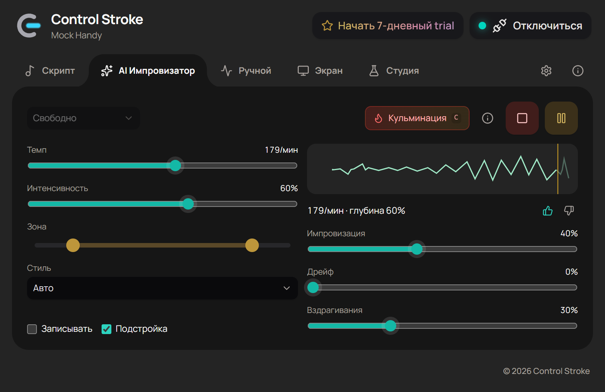

# Control Stroke

**An AI improviser for The Handy that runs entirely on your PC.**

Control Stroke drives your device live: a small local model improvises motion while you steer it with sliders — tempo, intensity, zone, style, improvisation, drift. It learns what you like from 👍/👎 and from how you adjust it, and that taste profile never leaves your computer.

It is also a local-first controller for compatible devices through Intiface Central: funscript playback, manual patterns and Screen Sync.

18+ only. Use only with compatible devices you own and control. Keep device firmware, Intiface Central, and operating system permissions up to date.

## What makes it different

- **Live AI improviser.** No script needed: the model generates endless, non-repeating motion and reacts to slider changes within about a second.
- **Learns your taste, locally.** Likes, dislikes, slider corrections and session length shape what it plays next. Reset or export your profile any time.
- **Scenarios.** Ready-made arcs — tease, waves, build to peak, marathon — that you can take over at any moment.
- **Turn a session into a script.** Record what the improviser played and save it as a `.funscript`.
- **Private by design.** No telemetry, no cloud processing, no account for free use.

## Download

The first public release will be published in this repository's [Releases](https://github.com/ControlStroke/releases/releases).

Current status: `v0.1.0-rc1` is being prepared.

## Requirements

- Windows 10 or newer.
- [Intiface Central](https://intiface.com/central/) installed and running.
- A compatible device exposed through Intiface/Buttplug.
- Bluetooth pairing and OS permissions configured when required by the device.

## First Connection

1. Install and start Intiface Central.
2. Connect or pair your compatible device in the operating system if required.
3. Launch Control Stroke.
4. The app will try to connect to Intiface at `ws://127.0.0.1:12345`.
5. If your Intiface WebSocket URL is different, open Settings and update the URL.
6. Use Scan if the device does not appear automatically.

## Core Features

- Local Intiface connection.
- AI improviser with live sliders, scenarios, recording and on-device taste learning.
- Funscript playback from local files.
- Optional local video reference for script alignment.
- Manual control patterns.
- Screen Sync for motion-derived control.
- Local logs for troubleshooting.

## Privacy

Control Stroke is local-first:

- no telemetry;
- no cloud upload for scripts;
- no cloud upload for screen capture;
- the improviser model and your taste profile stay on your computer;
- no account required for free local use.

Future Pro unlocks will use Patreon-backed entitlement checks. The desktop app should receive only Control Stroke license data, not raw Patreon OAuth tokens.

See the full [Privacy Policy](PRIVACY.md).

## Terms

See the [Terms of Service](TERMS.md).

## Patreon

Patreon will be the only paid channel for Pro access and project updates. The Patreon page link will be added when the entitlement flow and launch copy are ready.

Free downloads will remain available from GitHub Releases.

## Troubleshooting

### The app cannot connect to Intiface

- Start Intiface Central first.
- Confirm the WebSocket server is enabled in Intiface Central.
- Check that the app URL matches the Intiface URL, usually `ws://127.0.0.1:12345`.
- Restart Intiface Central and try Connect again.

### The device does not appear

- Pair the device in Windows if needed.
- Confirm Intiface Central can see the device.
- Use Scan in Control Stroke.
- Check device battery, firmware, and Bluetooth permissions.

### Script playback does not start

- Confirm the file is a valid `.funscript` or compatible JSON file.
- Check the app logs for parsing errors.
- Stop other active control modes before starting playback.

### Screen Sync does not start

- Allow screen capture when Windows or the browser runtime asks.
- Stop other active control modes first.
- Lower sensitivity if the signal is noisy.
- Stop and restart Screen Sync after changing the captured window or display.

## Feedback

Use [GitHub Issues](https://github.com/ControlStroke/releases/issues) for bug reports, setup problems, and release feedback.

When reporting a problem, include:

- Windows version;
- Intiface Central version;
- Control Stroke release version;
- connection mode and device model;
- relevant log lines from the app.

Do not include private files, sensitive screenshots, or explicit media in public issues.
